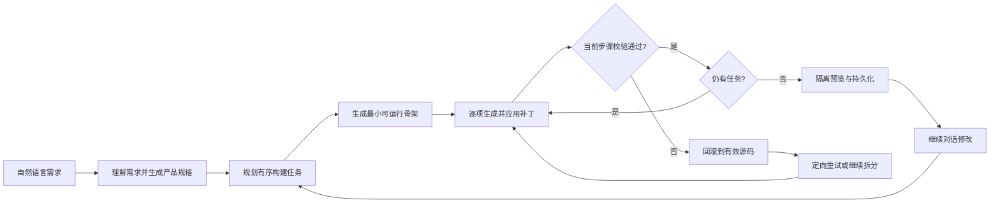

# MicroForge - Agent App Studio

[在线体验](https://microforge-app-studio.brownbrook128.chatgpt.site/) · [交付说明](./DELIVERY.md) · [架构设计](./docs/ARCHITECTURE.md) · [验收清单](./docs/ACCEPTANCE.md)

MicroForge 是一个可运行的 AI 应用生成工作台。用户用自然语言描述需求，Agent 会先形成产品规格，再把需求拆成有序的小任务，逐步生成并校验单文件 Web 应用。生成结果可在隔离 iframe 中直接操作，也可以继续对话修改、恢复历史版本或导出 HTML。

## 核心体验

- 初始化：填写邮箱即可建立当前浏览器的本地工作区，无需验证码。
- 通用生成：不依赖预设模板，可生成待办、看板、预算工具、小游戏等不同类型的应用。
- 真实交互：生成结果包含 HTML、CSS 和 JavaScript，可在预览区直接操作。
- 多轮修改：Agent 基于现有规格和源码理解新要求，并保留未要求变更的功能和数据。
- 逐步构建：复杂需求会拆成多个有序子任务，逐个应用小型补丁并立即校验。
- 自动恢复：补丁失败时回滚到上一个有效结果，定向重试；仍失败则进一步拆分。
- 数据持久化：账户、项目、版本和生成应用的运行数据保存在当前浏览器。
- 项目管理：支持重命名、删除、版本恢复、备份导入导出及独立 HTML 导出。
- 异常处理：模型或网络调用失败时展示明确错误，并提供重新生成入口。

## Agent 工作流



每个生成结果都会进行结构、脚本、交互、持久化桥、存储边界和外部网络调用等检查。生成应用不能直接访问宿主的 `localStorage`，只能通过 `window.microforgeStore` 与宿主进行受控数据读写。

## 技术方案

- Next.js 16、React 19、TypeScript
- DeepSeek API：`https://api.deepseek.com`，默认模型 `deepseek-flash`
- Next.js Route Handler：请求校验、Agent 阶段编排、错误归一化
- iframe `sandbox`：隔离运行生成的单文件应用
- `postMessage` + 受控存储桥：保存生成应用的运行数据
- 浏览器 `localStorage`：保存工作区、项目、版本和业务数据
- Zod：产品规格和生成结果的结构校验

详细设计见 [docs/ARCHITECTURE.md](./docs/ARCHITECTURE.md)。

## 本地运行

要求 Node.js `>= 22.13.0`。

```bash
cp .env.example .env.local
npm ci
npm run dev
```

在 `.env.local` 中配置：

```dotenv
DEEPSEEK_BASE_URL=https://api.deepseek.com
DEEPSEEK_MODEL=deepseek-flash
DEEPSEEK_API_KEY=your_deepseek_api_key
```

`DEEPSEEK_API_KEY` 只在服务端 Route Handler 中读取，不会发送到浏览器，也不应提交到 Git。`.env.local` 已被 `.gitignore` 排除。

无外部密钥进行本地流程验证时，可临时设置 `MICROFORGE_DEV_MOCK=1`；生产环境不会启用该模式。

## 工程检查

```bash
npm run typecheck
npm run lint
npm run build
```

完整人工验收步骤见 [docs/ACCEPTANCE.md](./docs/ACCEPTANCE.md)。推荐使用“生成一个待办事项应用，支持添加、完成和删除任务”作为综合演示场景。

## 数据与安全边界

- 邮箱仅用于标识当前浏览器中的本地工作区，不发送验证邮件。
- 需求文本和当前应用上下文会发送给 DeepSeek 用于生成。
- 用户项目默认不上传数据库；清理站点数据或关闭无痕会话会删除这些本地内容。
- 生成代码运行在不含 `allow-same-origin` 的沙箱中。
- 生成应用禁止直接使用 Cookie、IndexedDB、`localStorage` 或 `sessionStorage`。
- 导出的独立 HTML 会使用自己的本地存储命名空间保存运行数据。

## 当前边界

- 当前采用浏览器本地持久化，不支持跨设备同步或多人协作。
- 生成质量和耗时受模型服务、配额与网络状况影响。
- 产物以单文件 HTML 为主，不覆盖需要后端数据库、原生应用或多仓库部署的需求。

本仓库为笔试交付的最终快照，不包含开发过程中的中间版本。
