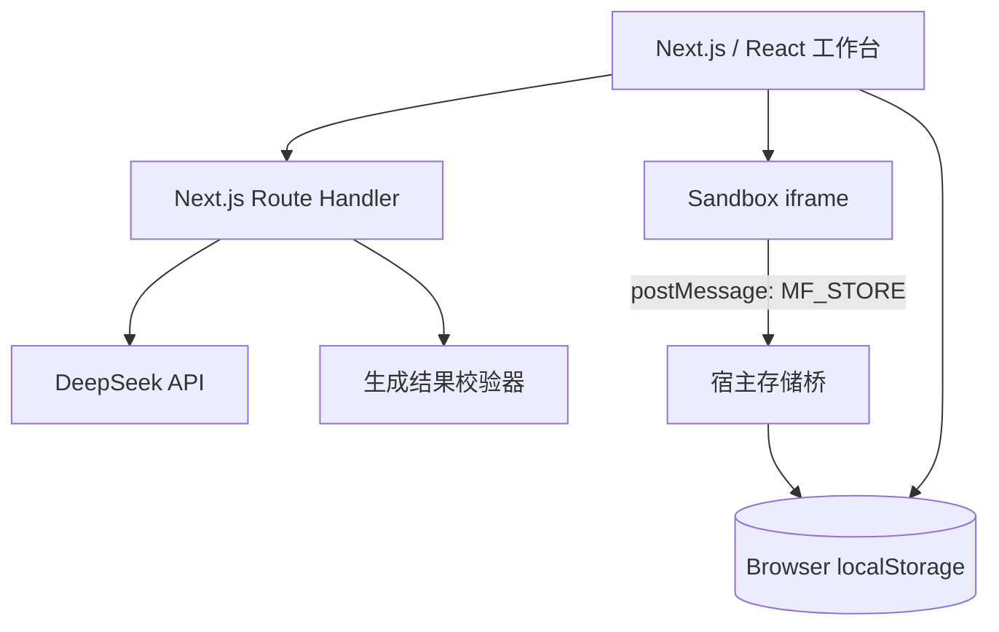
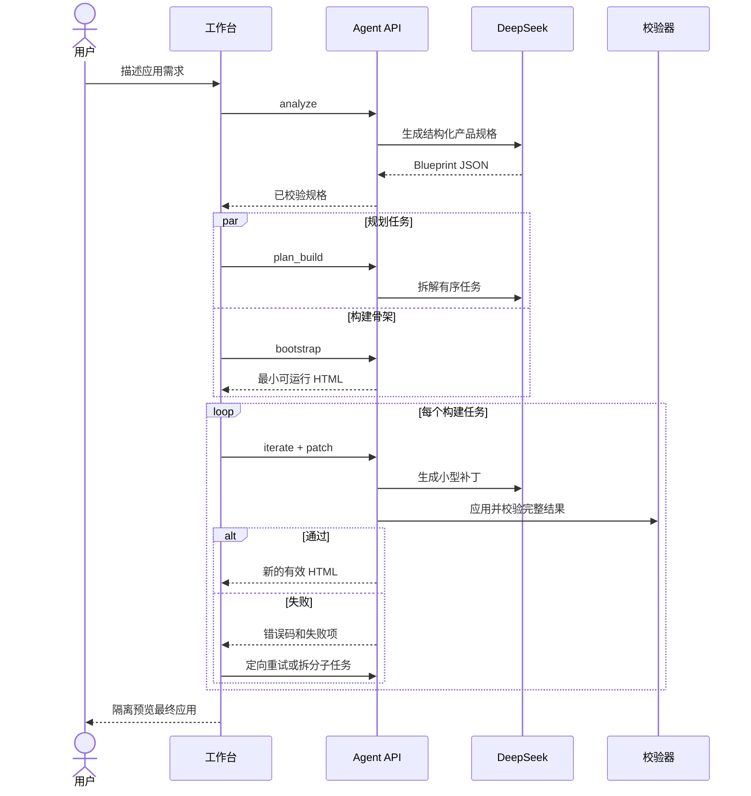

# 架构与 Agent 工作流

## 系统结构

### 前端工作台

负责初始化、项目列表、需求输入、Agent 进度、多轮记录、Preview / Spec / Code 切换、版本恢复和导出。工作台只保存模型返回的有效版本，失败过程不会覆盖用户当前应用。

### Route Handler

`app/api/generate/route.ts` 是 Agent 编排入口，负责：

- 校验输入和阶段参数；
- 调用 DeepSeek；
- 解析产品规格、构建计划与代码补丁；
- 应用补丁并执行结果检查；
- 归一化模型限长、配置、上游和格式错误；
- 返回前端可恢复的错误码。

### 生成结果校验

`lib/agent-schema.ts` 检查完整 HTML、标题、样式、脚本、交互、响应式设计、持久化桥、存储边界和外部网络调用。补丁应用后必须重新通过整体验证，才会进入项目版本。

## 初始构建时序

## 多轮修改策略

1. `revise` 更新完整产品规格，同时要求数据模型向后兼容。
2. 修改范围较大时调用 `plan_patch` 拆成顺序任务。
3. 每个任务仅生成边界明确的文本补丁，不返回完整 HTML。
4. 服务端在上一个有效源码副本上应用补丁并重新运行全部检查。
5. 格式、定位、大小或校验失败时丢弃结果，携带具体失败项重试。
6. 重试仍失败时继续拆分，直到成功或达到安全预算并返回明确错误。

该策略避免输出长度随功能增长而不断扩大，也避免一次失败破坏整个应用。

## 持久化边界

| 数据 | 保存位置 | 说明 |
| --- | --- | --- |
| 本地资料 | `microforge.profile.v3` | 邮箱、名字和角色 |
| 项目与版本 | `microforge.projects.v3` | 规格、源码、检查、对话与版本 |
| 当前项目 | `microforge.active.v3` | 当前选择 |
| 应用运行数据 | `microforge.runtime.<projectId>` | 由沙箱存储桥代管 |

iframe 不包含 `allow-same-origin`。生成应用使用 `window.microforgeStore`，宿主仅接受来源为 opaque origin、类型为 `MF_STORE`、项目已存在且序列化后不超过 1 MB 的消息。

## 错误恢复

- `OUTPUT_TOO_LONG`：先压缩结构；复杂任务转为分步补丁。
- `PATCH_FORMAT_INVALID`：丢弃补丁并重新规划。
- `PATCH_APPLY_FAILED`：回滚后缩小修改范围。
- `PATCH_VALIDATION_FAILED`：把失败检查项加入定向重试提示。
- 网络或模型错误：在界面保留需求，显示原因并提供“重新生成”。
- 达到拆分预算：停止继续尝试，保留现有版本并提示用户缩小单次需求。
